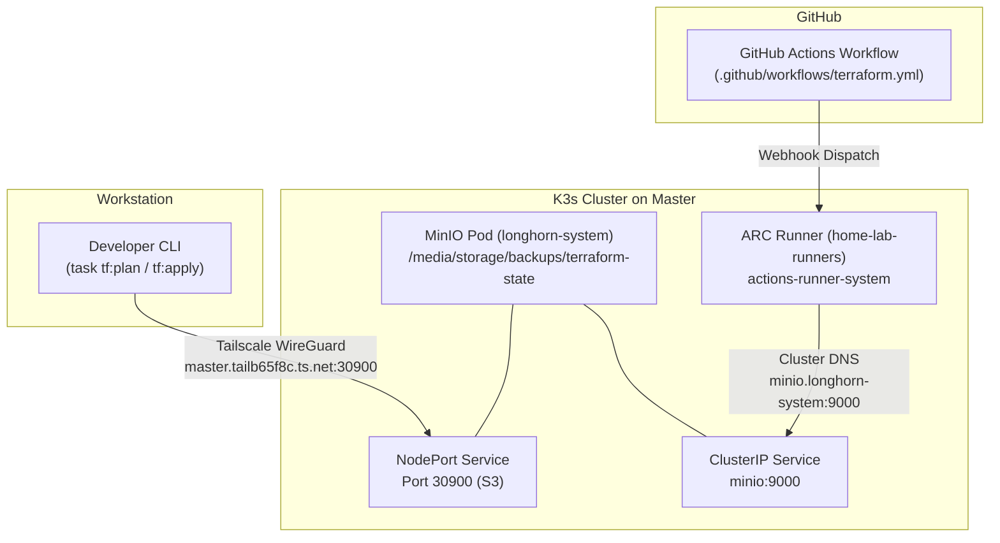

# Terraform Infrastructure as Code & GitOps Pipeline

This document describes the Terraform / OpenTofu remote state backend architecture, local development workflows, and automated CI/CD GitOps pipeline for the homelab.

---

## 1. Architecture Overview

Terraform configurations manage external cloud and service resources across three providers:
1. **Cloudflare:** DNS records, Argo Tunnel (`vps-shield-tunnel`), ingress rules.
2. **Uptime Kuma:** Decentralized push monitors and Slack notification channels.
3. **Healthchecks.io:** Scraper cron deadline check and alerting integration.

### Remote State Backend Architecture

Terraform state is stored in an S3-compatible remote backend hosted by MinIO on node `master`:
* **Bucket:** `terraform-state`
* **Key:** `homelab/terraform.tfstate`
* **Region:** `us-east-1`
* **State Locking:** Native S3 state locking enabled via `use_lockfile = true` in OpenTofu 1.13+ (creates `.tflock` objects via S3 conditional writes, eliminating need for external DynamoDB).
* **Storage Location:** Backed by hostPath mount `/media/storage/backups` on the attached 1TB SSD of `master`.



---

## 2. Network Topology & Access Endpoints

To support both local development over the mesh VPN and containerized CI/CD execution inside K3s, two endpoints are available:

| Context | Endpoint URL | Route & Security |
| :--- | :--- | :--- |
| **Local Workstation** | `http://master.tailb65f8c.ts.net:30900` | Encrypted Tailscale WireGuard mesh |
| **GitHub Actions (ARC)** | `http://minio.longhorn-system.svc.cluster.local:9000` | K3s internal service mesh / DNS |
| **MinIO Web Console** | `http://master.tailb65f8c.ts.net:30901` | Tailscale NodePort 30901 |

---

## 3. Credential Management

### S3 Backend Credentials

Export `AWS_ACCESS_KEY_ID` and `AWS_SECRET_ACCESS_KEY` from macOS Keychain or an untracked local environment file before running backend operations. `task tf:init`, `task tf:plan`, `task tf:apply`, and `task tf:destroy` reject missing or empty credentials before invoking OpenTofu. The Taskfile has no credential defaults and passes credentials through the process environment, never backend command arguments.

GitHub Actions supplies these variables through repository secrets `MINIO_ACCESS_KEY` and `MINIO_SECRET_KEY`. Formatting and configuration validation do not require backend credentials.

The existing MinIO deployment still shares root credentials with Longhorn backups. Removing the Taskfile fallbacks does not rotate those credentials or remove their historical exposure. Rotation and separate Terraform/Longhorn users require coordinated changes to MinIO, the Longhorn backup secret, CI secrets, and local credential storage.

### Provider Secrets

Sensitive provider tokens and credentials must never be committed to Git:
* **Local Workstations:** Stored in untracked `terraform/terraform.tfvars` (modeled in `terraform/terraform.tfvars.example`) and macOS Keychain:
  * `CLOUDFLARE_API_TOKEN`: `security find-generic-password -s "cloudflare_api_token" -w`
  * `healthchecks_api_key`: `security find-generic-password -s "healthchecks_api_key" -w`
* **GitHub Actions:** Stored as GitHub Actions repository secrets:
  * `MINIO_ACCESS_KEY` and `MINIO_SECRET_KEY` for the S3 backend
  * `CLOUDFLARE_API_TOKEN`
  * `CLOUDFLARE_EMAIL`
  * `TF_VAR_ACCOUNT_ID`
  * `TF_VAR_KUMA_PASSWORD`
  * `TF_VAR_KUMA_SLACK_WEBHOOK_URL`
  * `TF_VAR_HEALTHCHECKSIO_API_KEY`

---

## 4. Local Development Workflows

Common operations are executed via `task` recipes in the repository root:

`task tf:test` checks rejection of missing and empty credentials, environment forwarding, and argument preservation for all four backend operations using a local Terraform stub. It never contacts MinIO or the managed providers. `task swarm:test` checks the Caddy deploy token guard with a local Docker stub and never contacts Docker. `task ci:lint` checks the Terraform and Swarm validation workflows plus their shell scripts with actionlint and shellcheck.

### Initialize Backend & Providers
```bash
task tf:init
```
To change the endpoint for the same bucket/key without migrating state:
```bash
task tf:init -- -reconfigure
```

For an intentional backend migration, stop other writers, capture a verified state backup, and use `task tf:init -- -migrate-state`. Reconfiguration does not copy state between backends. Confirm resource identities and a no-change plan before resuming automation.

### Validate Configuration
```bash
task tf:fmt
task tf:validate
```

### Plan Changes
```bash
task tf:plan
```

### Apply Changes
```bash
task tf:apply
```

---

## 5. Automated CI/CD GitOps Pipeline

The workflow [.github/workflows/terraform.yml](../.github/workflows/terraform.yml) runs on push and pull requests affecting `terraform/**`, `Taskfile.yaml`, `scripts/ci/**`, `tests/**`, or the Terraform workflow itself:

1. **Self-Hosted Execution & Security Guard:** Executes on `runs-on: home-lab-runners` pinned to `master`. Job restricts execution to internal repository branches (`if: github.event_name != 'pull_request' || github.event.pull_request.head.repo.full_name == github.repository`) to protect cluster-admin runner credentials against untrusted public fork code execution.
2. **Network Resilience:** Enforces GLIBC IPv4 resolution (`precedence ::ffff:0:0/96 100` and `GODEBUG="netdns=cgo"`) to prevent IPv6 timeouts on container egress.
3. **Tool Bootstrapping:** Automatically downloads architecture-aware binaries for `task` (v3.52.0) and `opentofu` (v1.13.1) with connection retries.
4. **Validation Gate:** Runs offline backend credential checks (`task tf:test`), format checks (`task tf:fmt -- -check`), backend initialization (`task tf:init`), and syntax validation (`task tf:validate`).
5. **Speculative Plan on Pull Requests:** Runs `task tf:plan` on PRs without applying resource changes. Planning can acquire and release the backend's `.tflock` object.
6. **Automated Apply on Merge:** Runs `task tf:apply -- -auto-approve` automatically when changes merge to `master`.

The separate [Swarm Validation workflow](../.github/workflows/swarm-validation.yml) runs `task swarm:test` on changes to Swarm stack files, the task definition, CI setup scripts, or test files. It uses an Ubuntu-hosted runner and does not access Terraform credentials or deploy a stack.

---

## 6. Disaster Recovery & State Inspection

### Pull State via CLI
With backend credentials exported, capture a private backup in the gitignored Terraform state filename pattern:
```bash
umask 077
state_backup=$(mktemp "$PWD/terraform/terraform.tfstate.backup.XXXXXXXX")
tofu -chdir=terraform state pull > "$state_backup"
```

Run these commands from the repository root. Continue only if `state pull` exits successfully and the captured state contains the expected resource identities, lineage, and serial. Remove a partial file after a failed pull. State contains provider secrets and tunnel credentials; do not print it in CI logs or commit it.

### Restore State

Stop other state writers and compare the backup with the current backend state before restoring. Use OpenTofu's backend-aware operation instead of copying a local `terraform.tfstate` file:

```bash
tofu -chdir=terraform state push "$state_backup"
```

Keep state locking, lineage checks, and serial checks enabled. A rejected push needs investigation; do not bypass these safeguards with `-force` or `-lock=false`. Restoring a state snapshot does not undo changes to live resources. Follow restoration with `task tf:plan -- -detailed-exitcode` and review every difference before applying anything.

### State Lock Release
If a process terminates unexpectedly while holding an S3 state lock, first verify that the owning process and workflow are no longer running. Only then release its recorded lock ID:
```bash
tofu -chdir=terraform force-unlock <LOCK_ID>
```

### Direct S3 Inspection
If direct S3 access is required and AWS CLI is available, retrieve the object into a private, gitignored file. Do not read MinIO's hostPath files as if they were exported S3 objects:
```bash
umask 077
state_backup=$(mktemp "$PWD/terraform/terraform.tfstate.backup.XXXXXXXX")
aws --endpoint-url http://master.tailb65f8c.ts.net:30900 s3 cp s3://terraform-state/homelab/terraform.tfstate "$state_backup"
```

### Backups
The MinIO data directory `/data` is mapped directly to `/media/storage/backups` on the attached 1TB SSD of `master`. The configured Longhorn recurring job backs up volumes into a different bucket on that same MinIO server; it does not back up Terraform state or the MinIO data directory.

This repository does not configure scheduled state exports, bucket versioning, or an independent backup of this state. Keep verified encrypted exports outside the home server before relying on recovery from SSD or site loss. An automated backup/restore exercise and a two-client lock-contention exercise remain unverified.
