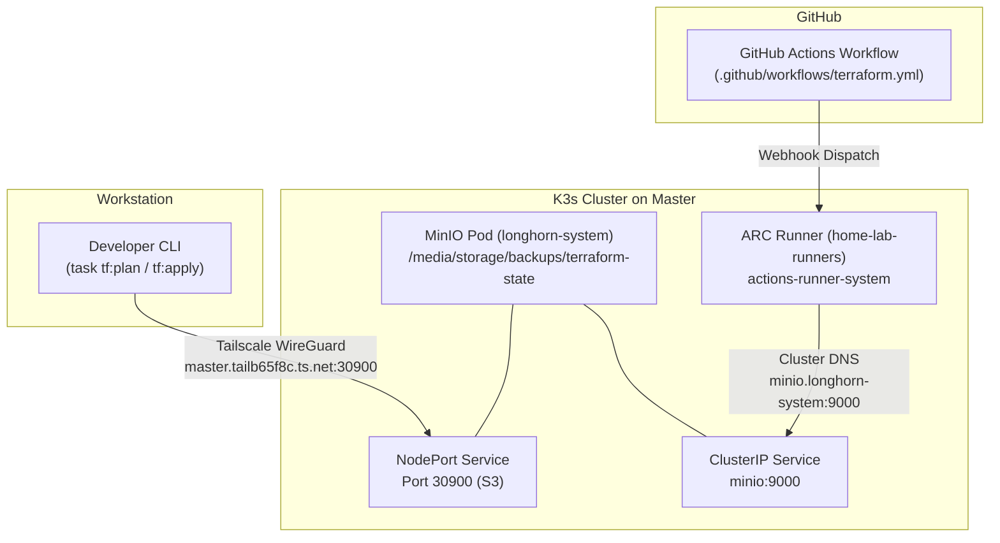

# Terraform Infrastructure as Code & GitOps Pipeline

This document describes the Terraform / OpenTofu remote state backend architecture, local development workflows, and automated CI/CD GitOps pipeline for the homelab.

---

## 1. Architecture Overview

Terraform configurations manage external cloud and service resources across three providers:
1. **Cloudflare:** DNS records, Argo Tunnel (`vps-shield-tunnel`), ingress rules.
2. **Uptime Kuma:** Decentralized push monitors and Slack notification channels.
3. **Healthchecks.io:** Scraper cron deadline check and alerting integration.

### Remote State Backend Architecture

Terraform state is stored in an S3-compatible remote backend hosted by MinIO on node `master`:
* **Bucket:** `terraform-state`
* **Key:** `homelab/terraform.tfstate`
* **Region:** `us-east-1`
* **Storage Location:** Backed by hostPath mount `/media/storage/backups` on the attached 1TB SSD of `master`.



---

## 2. Network Topology & Access Endpoints

To support both local development over the mesh VPN and containerized CI/CD execution inside K3s, two endpoints are available:

| Context | Endpoint URL | Route & Security |
| :--- | :--- | :--- |
| **Local Workstation** | `http://master.tailb65f8c.ts.net:30900` | Encrypted Tailscale WireGuard mesh |
| **GitHub Actions (ARC)** | `http://minio.longhorn-system.svc.cluster.local:9000` | K3s internal service mesh / DNS |
| **MinIO Web Console** | `http://master.tailb65f8c.ts.net:30901` | Tailscale NodePort 30901 |

---

## 3. Credential Management

### S3 Backend Credentials

MinIO uses root credentials defined in `k8s/charts/k3s-maintenance/templates/minio.yaml`:
* **AWS_ACCESS_KEY_ID:** `minioadmin`
* **AWS_SECRET_ACCESS_KEY:** `minioadminsecret`

Default values are pre-configured in [Taskfile.yaml](../Taskfile.yaml) and the GitHub Actions workflow environment.

### Provider Secrets

Sensitive provider tokens and credentials must never be committed to Git:
* **Local Workstations:** Stored in untracked `terraform/terraform.tfvars` (modeled in `terraform/terraform.tfvars.example`) and macOS Keychain:
  * `CLOUDFLARE_API_TOKEN`: `security find-generic-password -s "cloudflare_api_token" -w`
  * `healthchecks_api_key`: `security find-generic-password -s "healthchecks_api_key" -w`
* **GitHub Actions:** Stored as GitHub Actions repository secrets:
  * `CLOUDFLARE_API_TOKEN`
  * `CLOUDFLARE_EMAIL`
  * `TF_VAR_ACCOUNT_ID`
  * `TF_VAR_KUMA_PASSWORD`
  * `TF_VAR_KUMA_SLACK_WEBHOOK_URL`
  * `TF_VAR_HEALTHCHECKSIO_API_KEY`

---

## 4. Local Development Workflows

Common operations are executed via `task` recipes in the repository root:

### Initialize Backend & Providers
```bash
task tf:init
```
To reconfigure or migrate state:
```bash
task tf:init -- -reconfigure
```

### Validate Configuration
```bash
task tf:fmt
task tf:validate
```

### Plan Changes
```bash
task tf:plan
```

### Apply Changes
```bash
task tf:apply
```

---

## 5. Automated CI/CD GitOps Pipeline

The workflow [.github/workflows/terraform.yml](../.github/workflows/terraform.yml) runs on push and pull requests affecting `terraform/**` or `Taskfile.yaml`:

1. **Self-Hosted Execution:** Executes on `runs-on: home-lab-runners` pinned to `master`.
2. **Network Resilience:** Enforces GLIBC IPv4 resolution (`precedence ::ffff:0:0/96 100` and `GODEBUG="netdns=cgo"`) to prevent IPv6 timeouts on container egress.
3. **Tool Bootstrapping:** Automatically downloads architecture-aware binaries for `task` (v3.52.0) and `opentofu` (v1.9.0) with connection retries.
4. **Validation Gate:** Runs format checks (`task tf:fmt -- -check`), backend initialization (`task tf:init`), and syntax validation (`task tf:validate`).
5. **Speculative Plan on Pull Requests:** Runs `task tf:plan` on PRs to provide visibility into proposed infrastructure modifications without mutating state.
6. **Automated Apply on Merge:** Runs `task tf:apply -- -auto-approve` automatically when changes merge to `master`.

---

## 6. Disaster Recovery & State Inspection

### Direct State Retrieval
To inspect the current remote state without initializing OpenTofu:
```bash
kubectl exec -n longhorn-system deployment/minio -- ls -la /data/terraform-state/homelab/terraform.tfstate
```

### Pull State via CLI
```bash
tofu -chdir=terraform state pull > state-backup.json
```

### Backups
The MinIO data directory `/data` is mapped directly to `/media/storage/backups` on the attached 1TB SSD of `master`. Nightly backups include this directory alongside Longhorn snapshots.
